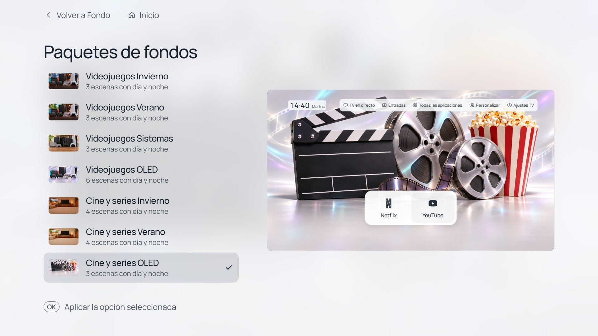
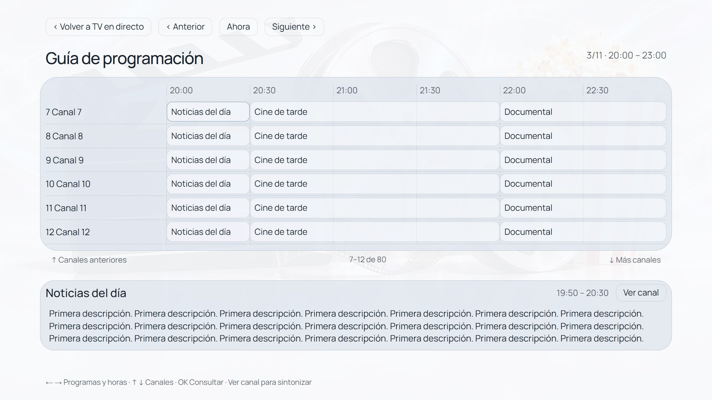

# CleanFrame · Samsung S93D OLED

**Release 1.2 — [Cambios en español / English changes](docs/releases/1.2.md)**

A personal TV launcher adapted for the **Samsung TQ48S93DAEXXC (48-inch S93D OLED)**, based on [nthnclrk/CleanFrame](https://github.com/nthnclrk/CleanFrame). The TV interface is in Spanish. Documentation and screenshot captions are available in both languages.

Un menú personal para la **Samsung TQ48S93DAEXXC (S93D OLED de 48 pulgadas)**, basado en CleanFrame. Interfaz en español; documentación y pies de captura en español e inglés.

**[English guide](docs/bedroom/README.en.md) · [Guía en español](docs/bedroom/README.es.md)**

[Project record / Registro del proyecto](docs/bedroom/PROJECT.md) · [Screenshots / Capturas](docs/bedroom/SCREENSHOTS.md) · [Upstream README](README.upstream.md)


## Features / Funciones

- Installed TV apps only, with a configurable, reorderable carousel. / Solo aplicaciones instaladas, con carrusel configurable y ordenable.
- HDMI shortcuts with editable names and monochrome Steam, Nintendo Switch and PS5 icons. / Accesos HDMI con nombres editables e iconos monocromos.
- Live TV preview, scrollable channel list, tuning and optional carousel shortcut. / TDT con vista previa, lista desplazable, cambio de canal y acceso opcional en el carrusel.
- Separate launcher customization and Samsung quick settings. / Personalización del menú y ajustes rápidos de Samsung separados.
- 24-hour clock and weekday; consistent focus and visible Back/Home controls. / Hora de 24 horas, día de la semana y controles visibles para volver e ir a inicio.
- 52 backgrounds in seven packages (26 day/night pairs), with design masters and generation prompts. / 52 fondos en siete paquetes (26 parejas día/noche), con originales y descripciones de generación.

## Preview / Vista previa

Requires Node.js 22.13+ or 24+, Python 3.10+, and npm. / Requiere Node.js 22.13+ o 24+, Python 3.10+ y npm.

```sh
git clone https://github.com/pettersdark/Samsung-TQ48S93DAEXXC-CleanFrame.git
cd Samsung-TQ48S93DAEXXC-CleanFrame
npm ci
python scripts/preview.py --public-fonts
```

On macOS/Linux, use `python3` if needed. Open http://localhost:4795/home/. Use arrows, Enter and Escape. Actual TV actions require a compatible TV. / En macOS/Linux usa `python3` si corresponde. Abre la dirección anterior; usa flechas, Intro y Escape. Las funciones del televisor requieren una TV compatible.

## Installation and limits / Instalación y límites

Read the language guide before installing. Use your own Samsung developer certificates and SDK-generated app identity. This repository contains source, assets and documentation, without personal keys, signed packages or device recovery state. Native Home/startup integration is a separate, firmware-specific operation; **always opening this launcher at power-on is not guaranteed**.

Lee la guía antes de instalar. Usa certificados de desarrollador propios y una identidad de aplicación generada por el SDK. El repositorio contiene código, recursos y documentación; excluye claves personales, paquetes firmados y datos de recuperación. La integración con Inicio y el arranque depende del firmware; **no se garantiza que este menú aparezca siempre al encender**.

## Credits and licences / Créditos y licencias

CleanFrame by Nathan Clark and contributors; bedroom adaptation for pettersdark. Preserve [LICENSE](LICENSE) and [THIRD_PARTY_NOTICES.md](THIRD_PARTY_NOTICES.md). Brand logos retain their owners' rights. Generated wallpaper provenance is recorded in `app/assets/wallpapers/SOURCES.json`; prompts and selected masters are in `design/backgrounds/`. No Samsung or platform endorsement is claimed.

## Wallpaper packages and inline clock / Paquetes y reloj en una línea

This update replaces the previous gallery with seven offline packages / 52 images.
Package selection, scene rotation and automatic day/night timing are in
Personalizar → Fondo. The 24-hour time and weekday share one line. Existing
Home/startup behavior is preserved for this model.

Esta actualización sustituye la galería anterior por siete paquetes / 52 fondos.
En Personalizar → Fondo se elige paquete, escena, rotación y horario día/noche.
Hora y día van en una línea. Se conserva el comportamiento de Casa y arranque.
[Behavior and validation / Uso y pruebas](docs/wallpaper-packs.md).



## Programme guide 1.2 / Guía de programación 1.2

Live TV includes a compact channel list, higher 16:9 preview, title/time/progress, next programme and three visible lines of scrollable synopsis. The separate guide shows six channels and three hours per page, with duration-proportional bars and rounded day/night panels. Browse with arrows; OK consults; Ver canal explicitly tunes live TV. Back restores the preview.

TV en directo incluye lista compacta, vídeo más arriba, título/horario/progreso, siguiente programa y tres líneas de sinopsis desplazable. La guía independiente muestra seis canales y tres horas, con barras proporcionales y marcos redondeados de día/noche. Flechas para recorrer, OK para consultar y Ver canal para sintonizar. Atrás vuelve a la vista previa.

The owner confirmed Live TV and the programme guide on this model. El propietario confirmó TV en directo y la guía de programación en este modelo.

Home and power-on open CleanFrame. Casa y encendido abren CleanFrame. No native Home/startup changes are included. / Sin cambios nativos de Casa/arranque. Broadcaster metadata may be missing; no internet EPG provider is included. / Puede faltar información emitida por las cadenas; sin proveedor EPG externo.



[Changes, validation and download / Cambios, pruebas y descarga](docs/releases/1.2.md). Screenshots show the shared browser interface with sample data, not photographs of this TV. / Capturas de la interfaz compartida en navegador con datos de ejemplo, no fotos de este televisor.
